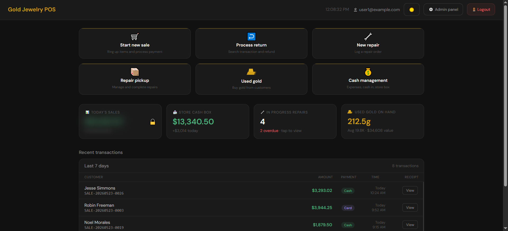
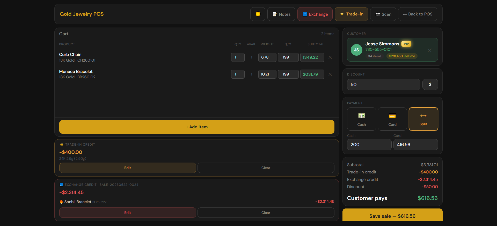
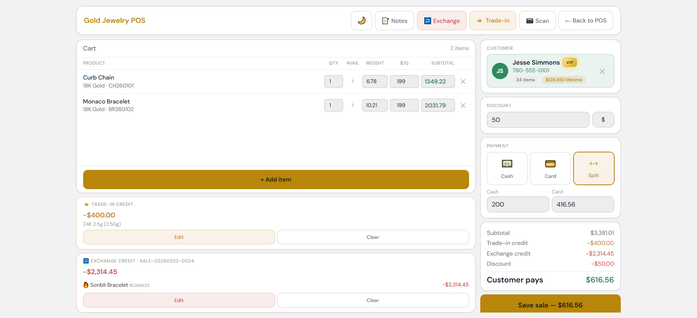
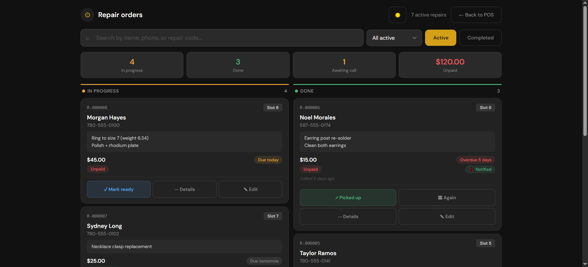
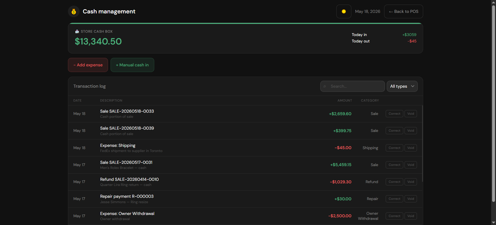
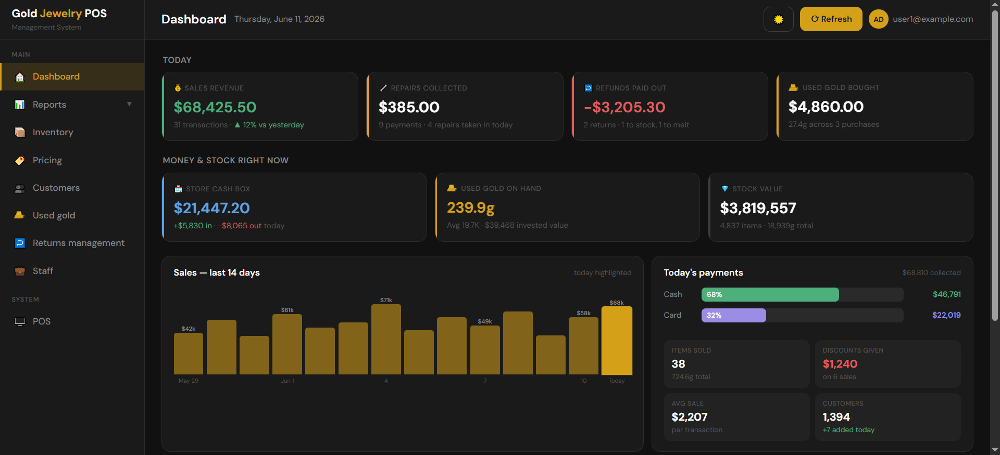
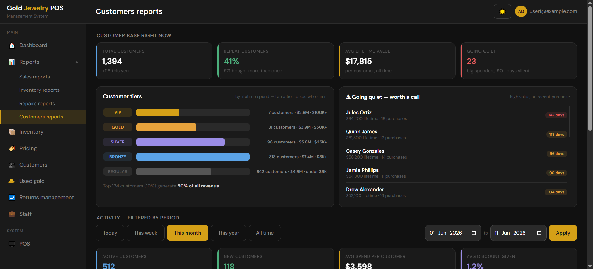

# Gold Jewelry POS

**Live demo:** https://oussamaadi.github.io/Gold-Jewelry-POS/ (or open `index.html` locally)

**Specification:** [docs/specification.md](docs/specification.md), the page-by-page implementation reference I wrote for the development team.

Interactive prototypes of a point-of-sale (POS) and back-office admin system for a gold jewelry store. The store had no POS, so I defined how the whole store should run and told the development team exactly what to build. When their first version did not match what I wanted, I designed every workflow, screen and business rule as these clickable pages, and the team rebuilt the production system from them.

> All customers, staff, phone numbers, emails and sales figures in this demo are **fictional**.

## Screenshots

**POS dashboard**

**New sale (dark mode)**

**New sale (light mode)**

**Repair orders**

**Cash management**

**Admin dashboard**

**Customer reports**

## The problem

Off-the-shelf retail POS systems don't fit a gold jewelry store:

- **Prices move with the gold market.** Items are priced by **weight × price per gram for each karat**, plus labour, not by a fixed sticker price.
- **Customers trade in and exchange gold.** A sale often includes used gold coming in as credit.
- **The store buys used gold** from customers and has to track its weight and purity until it is melted.
- **Repairs are a big part of the business.** Each one needs a ticket, a storage slot, a due date and a pickup step.
- Staff work on an **iPad at the counter**, so every core screen had to fit without scrolling.

## What I did

1. **Requirements:** defined every daily task at the counter and in the back office, and the information each one needs.
2. **Workflows and business rules:** for example, editing a line's subtotal back-calculates the price per gram, "apply to all 21K" sets one price across the cart, split payments must add up exactly, and returns are checked against the original receipt.
3. **Screen design:** built 18 interactive pages (7 POS, 11 admin) with one consistent design system, including light and dark mode and large touch targets.
4. **Handoff:** after the developers' first build missed the mark, wrote a page-by-page implementation reference for the development team ([`docs/specification.md`](docs/specification.md)) so they could rebuild each screen and its rules exactly.
5. **Testing:** tested the delivered system against these requirements and followed up with the vendor on any gaps.

## Pages

**POS (counter, tablet)**
| Page | Key features |
|---|---|
| Dashboard | Six main actions; today's sales hidden behind a PIN; cash box balance; open and overdue repairs; used gold on hand |
| New sale | Cart priced by weight and karat; trade-in and exchange credit; customer tiers by lifetime spend; cash, card or split payment |
| Returns | Find the original receipt, choose items, refund method |
| Repair intake | Customer, item, notes, storage slot, due date |
| Repair orders | Status tracking, overdue highlighting, pickup |
| Used gold | Buying gold from customers by weight and karat |
| Cash management | Cash in and out, corrections with required reasons and notes |

**Admin (back office)**
Dashboard · Sales, inventory, repairs and customer reports · Inventory · Pricing by karat · Customers · Used gold stock and melting · Returns management · Staff accounts and roles

## Design decisions

- **One screen, no scrolling** for every counter task, so staff never lose context while a customer is waiting.
- **Price per gram is the core pricing unit**, editable in both directions, because that is how staff and customers talk about price.
- **Sensitive numbers are hidden by default.** Today's revenue needs a PIN and re-blurs after 5 seconds.
- **Every money movement records its payment method.** Cash, card and split are always explicit, so the cash box reconciles at the end of the day.
- **Corrections, not edits.** Past cash entries can never be edited, because that would destroy the audit trail. A mistake is fixed with a correction or a void that stays in the log next to the original.
- **Owner Withdrawal needs a PIN.** The PIN isn't there to stop the owner taking money from their own store. It stops employees from logging fake withdrawals to cover theft.
- **Trade-ins and exchanges happen on the sale page.** One transaction, one receipt, and the cash counter only sees the net cash that actually moved. Splitting it across two pages would create two records the system can't link.

## Built with

HTML, CSS and vanilla JavaScript (no frameworks), with sample data held in JavaScript.

Prototyped with AI assistance (Claude); every workflow, screen and business rule is my own design.

## Author

Oussama Adi, Edmonton, AB · [LinkedIn](https://www.linkedin.com/in/oussama-adi-6340aa23b)
